# 12. Database: ERD, schema, migratsiya strategiyasi

PostgreSQL 16. **7 sxema, 44 jadval** — har sxema bitta backend modulga tegishli. Kutubxona jadvallari (`event_publication` — Spring Modulith, `shedlock` — ShedLock, `flyway_schema_history`) bu hisobga kirmaydi.

| Sxema | Modul | Jadvallar |
| --- | --- | --- |
| `identity` | identity | `users`, `oauth_accounts`, `refresh_tokens`, `one_time_tokens`, `user_settings`, `follows` |
| `content` | content | `languages`, `topics`, `exercises`, `tags`, `exercise_tags`, `exercise_reports` |
| `training` | training | `user_languages`, `user_topic_progress`, `user_exercise_best`, `sessions`, `session_exercises`, `session_keylogs`, `session_char_stats` |
| `analytics` | analytics | `user_language_stats`, `user_daily_stats`, `user_char_stats`, `user_bigram_stats`, `processed_sessions` |
| `gamification` | gamification | `user_progress`, `xp_transactions`, `streak_freeze_usages`, `achievements`, `user_achievements`, `personal_records`, `challenge_templates`, `challenges`, `user_challenges`, `leaderboard_entries`, `competitions`, `competition_entries`, `user_notifications` |
| `coach` | coach | `goals`, `plans`, `plan_items`, `reports`, `llm_calls` |
| `admin` | admin | `audit_log`, `product_daily_metrics` |

## 1. Umumiy qoidalar

- PK: `BIGINT GENERATED ALWAYS AS IDENTITY`; sessiya — `UUID` (v7, ilova generatsiya qiladi).
- Vaqt: `TIMESTAMPTZ`, UTC. Sana (foydalanuvchi kuni): `DATE`.
- Enum: `VARCHAR` + `CHECK` (PostgreSQL `ENUM` turi ishlatilmaydi — migratsiyasi qiyin).
- Pul/metrika: `NUMERIC(p,s)`; float ishlatilmaydi.
- Har o'zgaruvchan jadvalda `created_at`, `updated_at`; optimistic lock kerak joyda `version INT`.
- **Modullararo FK** faqat `identity.users(id)` va `content.*` katalog jadvallariga ruxsat. Boshqa modul jadvaliga (masalan `gamification` → `training.sessions`) FK yo'q — ID saqlanadi, yaxlitlik hodisalar va idempotentlik bilan.
- `ON DELETE`: foydalanuvchiga tegishli ma'lumotlar akkaunt anonimlashtirilganda **ilova tomonidan** o'chiriladi (`BL-UM-4`); `CASCADE` faqat `identity` ichida.
- Kengaytmalar: `citext`, `pg_partman`, `pg_stat_statements`.

## 2. ERD (asosiy bog'lanishlar)

```mermaid
erDiagram
  USERS ||--o{ OAUTH_ACCOUNTS : has
  USERS ||--o{ REFRESH_TOKENS : has
  USERS ||--|| USER_SETTINGS : has
  USERS ||--o{ USER_LANGUAGES : selects
  LANGUAGES ||--o{ USER_LANGUAGES : selected
  LANGUAGES ||--o{ TOPICS : contains
  TOPICS ||--o{ EXERCISES : contains
  LANGUAGES ||--o{ EXERCISES : contains
  EXERCISES }o--o{ TAGS : tagged
  USERS ||--o{ USER_TOPIC_PROGRESS : tracks
  TOPICS ||--o{ USER_TOPIC_PROGRESS : tracked
  USERS ||--o{ USER_EXERCISE_BEST : best
  USERS ||--o{ SESSIONS : types
  LANGUAGES ||--o{ SESSIONS : in
  SESSIONS ||--|{ SESSION_EXERCISES : includes
  EXERCISES ||--o{ SESSION_EXERCISES : used
  SESSIONS ||--o| SESSION_KEYLOGS : has
  SESSIONS ||--o{ SESSION_CHAR_STATS : has
  USERS ||--o{ USER_LANGUAGE_STATS : aggregates
  USERS ||--o{ USER_DAILY_STATS : aggregates
  USERS ||--o{ USER_CHAR_STATS : aggregates
  USERS ||--|| USER_PROGRESS : has
  USERS ||--o{ XP_TRANSACTIONS : earns
  ACHIEVEMENTS ||--o{ USER_ACHIEVEMENTS : unlocked
  USERS ||--o{ USER_ACHIEVEMENTS : unlocks
  USERS ||--o{ PERSONAL_RECORDS : holds
  CHALLENGE_TEMPLATES ||--o{ CHALLENGES : instantiates
  CHALLENGES ||--o{ USER_CHALLENGES : progress
  USERS ||--o{ LEADERBOARD_ENTRIES : ranks
  COMPETITIONS ||--o{ COMPETITION_ENTRIES : entries
  USERS ||--o{ GOALS : sets
  USERS ||--o{ PLANS : gets
  PLANS ||--|{ PLAN_ITEMS : contains
  USERS ||--o{ REPORTS : receives
```



`training.sessions` → `analytics.*`, `gamification.*`, `coach.*` bog'lanishi FK emas, `SessionCompleted` hodisasi orqali (chizmada foydalanuvchi orqali ko'rsatilgan).

## 3. DDL

### 3.1 identity

```sql
CREATE EXTENSION IF NOT EXISTS citext;
CREATE SCHEMA identity;

CREATE TABLE identity.users (
  id                    BIGINT GENERATED ALWAYS AS IDENTITY PRIMARY KEY,
  email                 CITEXT NOT NULL UNIQUE,
  username              CITEXT NOT NULL UNIQUE
                        CHECK (username ~ '^[A-Za-z][A-Za-z0-9_]{2,19}$'),
  display_name          VARCHAR(40),
  password_hash         VARCHAR(255),                       -- OAuth-only akkauntda NULL
  role                  VARCHAR(16) NOT NULL DEFAULT 'USER'
                        CHECK (role IN ('USER','EDITOR','ADMIN')),
  status                VARCHAR(16) NOT NULL DEFAULT 'ACTIVE'
                        CHECK (status IN ('ACTIVE','BLOCKED','DELETED')),
  email_verified        BOOLEAN NOT NULL DEFAULT FALSE,
  country_code          CHAR(2),
  avatar_key            VARCHAR(200),                       -- obyekt xotirasidagi kalit
  bio                   VARCHAR(160),
  timezone              VARCHAR(64) NOT NULL DEFAULT 'UTC',
  timezone_changed_at   TIMESTAMPTZ,
  locale                VARCHAR(4) NOT NULL DEFAULT 'en'
                        CHECK (locale IN ('uzl','uzc','ru','en')),
  is_public             BOOLEAN NOT NULL DEFAULT TRUE,
  show_on_leaderboard   BOOLEAN NOT NULL DEFAULT TRUE,
  totp_secret           BYTEA,                              -- AES-GCM bilan shifrlangan
  totp_enabled          BOOLEAN NOT NULL DEFAULT FALSE,
  onboarded             BOOLEAN NOT NULL DEFAULT FALSE,
  onboarding_step       SMALLINT NOT NULL DEFAULT 1,
  experience            VARCHAR(16) CHECK (experience IN ('NEW','MID','SENIOR')),
  blocked_reason        VARCHAR(300),
  deletion_scheduled_at TIMESTAMPTZ,
  last_login_at         TIMESTAMPTZ,
  created_at            TIMESTAMPTZ NOT NULL DEFAULT now(),
  updated_at            TIMESTAMPTZ NOT NULL DEFAULT now(),
  version               INT NOT NULL DEFAULT 0
);
CREATE INDEX ix_users_country ON identity.users (country_code) WHERE status = 'ACTIVE';
CREATE INDEX ix_users_deletion ON identity.users (deletion_scheduled_at) WHERE status = 'DELETED';

CREATE TABLE identity.oauth_accounts (
  id           BIGINT GENERATED ALWAYS AS IDENTITY PRIMARY KEY,
  user_id      BIGINT NOT NULL REFERENCES identity.users(id) ON DELETE CASCADE,
  provider     VARCHAR(16) NOT NULL CHECK (provider IN ('GITHUB','GOOGLE')),
  provider_uid VARCHAR(100) NOT NULL,
  created_at   TIMESTAMPTZ NOT NULL DEFAULT now(),
  UNIQUE (provider, provider_uid),
  UNIQUE (user_id, provider)
);

CREATE TABLE identity.refresh_tokens (
  id           BIGINT GENERATED ALWAYS AS IDENTITY PRIMARY KEY,
  user_id      BIGINT NOT NULL REFERENCES identity.users(id) ON DELETE CASCADE,
  token_hash   CHAR(64) NOT NULL UNIQUE,                    -- SHA-256 hex
  family_id    UUID NOT NULL,
  replaced_by  BIGINT,                                      -- rotation zanjiri
  expires_at   TIMESTAMPTZ NOT NULL,
  revoked_at   TIMESTAMPTZ,
  user_agent   VARCHAR(300),
  ip           INET,
  last_used_at TIMESTAMPTZ,
  created_at   TIMESTAMPTZ NOT NULL DEFAULT now()
);
CREATE INDEX ix_refresh_user ON identity.refresh_tokens (user_id) WHERE revoked_at IS NULL;
CREATE INDEX ix_refresh_family ON identity.refresh_tokens (family_id);

CREATE TABLE identity.one_time_tokens (
  id          BIGINT GENERATED ALWAYS AS IDENTITY PRIMARY KEY,
  user_id     BIGINT NOT NULL REFERENCES identity.users(id) ON DELETE CASCADE,
  purpose     VARCHAR(16) NOT NULL CHECK (purpose IN ('VERIFY_EMAIL','RESET_PASSWORD')),
  token_hash  CHAR(64) NOT NULL UNIQUE,
  expires_at  TIMESTAMPTZ NOT NULL,
  used_at     TIMESTAMPTZ,
  created_at  TIMESTAMPTZ NOT NULL DEFAULT now()
);

CREATE TABLE identity.user_settings (
  user_id    BIGINT PRIMARY KEY REFERENCES identity.users(id) ON DELETE CASCADE,
  settings   JSONB NOT NULL DEFAULT '{}',                   -- 05 §5.17 kalitlari; yo'q kalit = standart qiymat
  updated_at TIMESTAMPTZ NOT NULL DEFAULT now()
);

CREATE TABLE identity.follows (
  follower_id BIGINT NOT NULL REFERENCES identity.users(id) ON DELETE CASCADE,
  followee_id BIGINT NOT NULL REFERENCES identity.users(id) ON DELETE CASCADE,
  created_at  TIMESTAMPTZ NOT NULL DEFAULT now(),
  PRIMARY KEY (follower_id, followee_id),
  CHECK (follower_id <> followee_id)
);
CREATE INDEX ix_follows_followee ON identity.follows (followee_id);
```

### 3.2 content

```sql
CREATE SCHEMA content;

CREATE TABLE content.languages (
  id                SMALLINT GENERATED ALWAYS AS IDENTITY PRIMARY KEY,
  slug              VARCHAR(32) NOT NULL UNIQUE CHECK (slug ~ '^[a-z][a-z0-9]*$'),
  name              VARCHAR(64) NOT NULL,                   -- tarjima qilinmaydi
  grammar_id        VARCHAR(32) NOT NULL,                   -- Shiki til ID
  indent_style      VARCHAR(8)  NOT NULL DEFAULT 'SPACE' CHECK (indent_style IN ('SPACE','TAB')),
  indent_size       SMALLINT    NOT NULL DEFAULT 4 CHECK (indent_size BETWEEN 1 AND 8),
  keyword_case      VARCHAR(8)  NOT NULL DEFAULT 'LOWER' CHECK (keyword_case IN ('LOWER','UPPER')),
  token_patterns    JSONB NOT NULL DEFAULT '[]',            -- [":=", "=>", ...]
  special_templates JSONB NOT NULL DEFAULT '{}',            -- {"BRACKETS": ["{ident}[{n}]", ...]}
  forbidden_patterns JSONB NOT NULL DEFAULT '[]',           -- BL-EM-3 regexlari
  release           SMALLINT NOT NULL DEFAULT 1,
  status            VARCHAR(16) NOT NULL DEFAULT 'DRAFT'
                    CHECK (status IN ('DRAFT','PUBLISHED','ARCHIVED')),
  sort_order        SMALLINT NOT NULL DEFAULT 0,
  created_at        TIMESTAMPTZ NOT NULL DEFAULT now(),
  updated_at        TIMESTAMPTZ NOT NULL DEFAULT now()
);

CREATE TABLE content.topics (
  id               INT GENERATED ALWAYS AS IDENTITY PRIMARY KEY,
  language_id      SMALLINT NOT NULL REFERENCES content.languages(id),
  slug             VARCHAR(64) NOT NULL CHECK (slug ~ '^[a-z0-9]+(-[a-z0-9]+)*$'),
  name             VARCHAR(100) NOT NULL,                   -- en
  description      VARCHAR(500),                            -- en
  name_i18n        JSONB NOT NULL DEFAULT '{}',             -- {"uzl":"…","uzc":"…","ru":"…"}
  description_i18n JSONB NOT NULL DEFAULT '{}',
  sort_order       SMALLINT NOT NULL,
  release          SMALLINT NOT NULL DEFAULT 1,
  status           VARCHAR(16) NOT NULL DEFAULT 'DRAFT'
                   CHECK (status IN ('DRAFT','PUBLISHED','ARCHIVED')),
  created_at       TIMESTAMPTZ NOT NULL DEFAULT now(),
  updated_at       TIMESTAMPTZ NOT NULL DEFAULT now(),
  UNIQUE (language_id, slug)
);

CREATE TABLE content.exercises (
  id               BIGINT GENERATED ALWAYS AS IDENTITY PRIMARY KEY,
  exercise_key     UUID NOT NULL,                           -- versiyalar bo'ylab barqaror
  version          INT  NOT NULL DEFAULT 1,
  language_id      SMALLINT NOT NULL REFERENCES content.languages(id),
  topic_id         INT REFERENCES content.topics(id),       -- SPECIAL_CHARS uchun NULL
  difficulty       VARCHAR(16) NOT NULL
                   CHECK (difficulty IN ('BEGINNER','INTERMEDIATE','ADVANCED','EXPERT')),
  exercise_type    VARCHAR(16) NOT NULL DEFAULT 'SNIPPET'
                   CHECK (exercise_type IN ('SNIPPET','SPECIAL_CHARS','CHALLENGE')),
  title            VARCHAR(150) NOT NULL,                   -- en, tarjima qilinmaydi
  note             VARCHAR(400),                            -- en
  note_i18n        JSONB NOT NULL DEFAULT '{}',
  code             TEXT NOT NULL,
  code_hash        CHAR(64) NOT NULL,
  char_count       INT NOT NULL,
  line_count       INT NOT NULL,
  special_ratio    NUMERIC(4,3) NOT NULL,
  nesting_depth    SMALLINT NOT NULL,
  char_freq        JSONB NOT NULL,
  bigram_freq      JSONB NOT NULL DEFAULT '{}',
  expected_seconds INT NOT NULL,
  ranked_pool      BOOLEAN NOT NULL DEFAULT FALSE,
  source           VARCHAR(300) NOT NULL DEFAULT 'original',
  status           VARCHAR(16) NOT NULL DEFAULT 'DRAFT'
                   CHECK (status IN ('DRAFT','IN_REVIEW','PUBLISHED','ARCHIVED')),
  created_by       BIGINT REFERENCES identity.users(id),
  reviewed_by      BIGINT REFERENCES identity.users(id),
  published_at     TIMESTAMPTZ,
  created_at       TIMESTAMPTZ NOT NULL DEFAULT now(),
  updated_at       TIMESTAMPTZ NOT NULL DEFAULT now(),
  UNIQUE (exercise_key, version),
  UNIQUE (language_id, code_hash),
  CHECK ((exercise_type = 'SPECIAL_CHARS') = (topic_id IS NULL)),
  CHECK (reviewed_by IS NULL OR reviewed_by <> created_by)
);
CREATE INDEX ix_exercises_pick ON content.exercises (language_id, topic_id, difficulty)
  WHERE status = 'PUBLISHED';
CREATE INDEX ix_exercises_ranked ON content.exercises (language_id)
  WHERE status = 'PUBLISHED' AND ranked_pool;
CREATE UNIQUE INDEX ux_exercises_one_published ON content.exercises (exercise_key)
  WHERE status = 'PUBLISHED';                                -- bir vaqtda bitta nashr qilingan versiya
CREATE INDEX ix_exercises_review ON content.exercises (status, created_at)
  WHERE status IN ('DRAFT','IN_REVIEW');

CREATE TABLE content.tags (
  id   INT GENERATED ALWAYS AS IDENTITY PRIMARY KEY,
  name VARCHAR(40) NOT NULL UNIQUE CHECK (name ~ '^[a-z0-9]+(-[a-z0-9]+)*$')
);
CREATE TABLE content.exercise_tags (
  exercise_id BIGINT NOT NULL REFERENCES content.exercises(id) ON DELETE CASCADE,
  tag_id      INT    NOT NULL REFERENCES content.tags(id) ON DELETE CASCADE,
  PRIMARY KEY (exercise_id, tag_id)
);

CREATE TABLE content.exercise_reports (
  id           BIGINT GENERATED ALWAYS AS IDENTITY PRIMARY KEY,
  exercise_id  BIGINT NOT NULL REFERENCES content.exercises(id),
  reporter_id  BIGINT NOT NULL REFERENCES identity.users(id),
  reason       VARCHAR(24) NOT NULL
               CHECK (reason IN ('SYNTAX_ERROR','WRONG_LEVEL','NOT_IDIOMATIC','TYPO','OTHER')),
  comment      VARCHAR(500),
  status       VARCHAR(16) NOT NULL DEFAULT 'OPEN' CHECK (status IN ('OPEN','RESOLVED','DISMISSED')),
  resolved_by  BIGINT REFERENCES identity.users(id),
  created_at   TIMESTAMPTZ NOT NULL DEFAULT now(),
  resolved_at  TIMESTAMPTZ,
  UNIQUE (exercise_id, reporter_id)
);
```

### 3.3 training

```sql
CREATE SCHEMA training;

CREATE TABLE training.user_languages (
  user_id      BIGINT   NOT NULL REFERENCES identity.users(id),
  language_id  SMALLINT NOT NULL REFERENCES content.languages(id),
  is_primary   BOOLEAN  NOT NULL DEFAULT FALSE,
  is_active    BOOLEAN  NOT NULL DEFAULT TRUE,
  start_level  VARCHAR(16) NOT NULL DEFAULT 'BEGINNER',
  placement_done BOOLEAN NOT NULL DEFAULT FALSE,
  added_at     TIMESTAMPTZ NOT NULL DEFAULT now(),
  PRIMARY KEY (user_id, language_id)
);
CREATE UNIQUE INDEX ux_user_primary_lang ON training.user_languages (user_id) WHERE is_primary;

CREATE TABLE training.user_topic_progress (
  user_id       BIGINT NOT NULL REFERENCES identity.users(id),
  topic_id      INT    NOT NULL REFERENCES content.topics(id),
  difficulty    VARCHAR(16) NOT NULL,
  state         VARCHAR(16) NOT NULL DEFAULT 'AVAILABLE'
                CHECK (state IN ('LOCKED','AVAILABLE','IN_PROGRESS','COMPLETED','MASTERED')),
  completed_cnt INT NOT NULL DEFAULT 0,
  mastered_cnt  INT NOT NULL DEFAULT 0,
  attempts_cnt  INT NOT NULL DEFAULT 0,
  completed_at  TIMESTAMPTZ,
  updated_at    TIMESTAMPTZ NOT NULL DEFAULT now(),
  PRIMARY KEY (user_id, topic_id, difficulty)
);
CREATE INDEX ix_utp_resume ON training.user_topic_progress (user_id, state, updated_at DESC);

CREATE TABLE training.user_exercise_best (
  user_id       BIGINT NOT NULL REFERENCES identity.users(id),
  exercise_key  UUID   NOT NULL,
  best_wpm      NUMERIC(6,2) NOT NULL,
  best_accuracy NUMERIC(5,2) NOT NULL,
  completed     BOOLEAN NOT NULL DEFAULT FALSE,              -- accuracy >= 95 bilan 100% yozilgan
  attempts      INT NOT NULL DEFAULT 1,
  last_session_id UUID NOT NULL,
  updated_at    TIMESTAMPTZ NOT NULL DEFAULT now(),
  PRIMARY KEY (user_id, exercise_key)
);

CREATE TABLE training.sessions (
  id               UUID NOT NULL,                            -- UUID v7
  user_id          BIGINT REFERENCES identity.users(id),     -- mehmon: NULL
  guest_id         UUID,
  language_id      SMALLINT NOT NULL REFERENCES content.languages(id),
  mode             VARCHAR(16) NOT NULL CHECK (mode IN
                   ('PRACTICE','SPEED_TEST','ACCURACY','CHALLENGE','SPECIAL_CHARS','WEAKNESS','CODE_SPRINT')),
  topic_id         INT,                                      -- so'ralgan mavzu (bo'lsa)
  difficulty       VARCHAR(16),
  duration_limit_s SMALLINT,                                 -- SPEED_TEST: 30/60/120; CHALLENGE: hisoblangan
  accuracy_master  BOOLEAN NOT NULL DEFAULT FALSE,
  is_placement     BOOLEAN NOT NULL DEFAULT FALSE,
  challenge_id     BIGINT,
  competition_id   BIGINT,
  special_category VARCHAR(16),
  gen_seed         BIGINT,                                   -- SPECIAL_CHARS generatsiyasi
  status           VARCHAR(16) NOT NULL DEFAULT 'STARTED'
                   CHECK (status IN ('STARTED','COMPLETED','ABANDONED','REJECTED')),
  input_device     VARCHAR(16) NOT NULL DEFAULT 'PHYSICAL' CHECK (input_device IN ('PHYSICAL','TOUCH')),
  strict_indent    BOOLEAN NOT NULL DEFAULT FALSE,
  engine_version   VARCHAR(16) NOT NULL,
  started_at       TIMESTAMPTZ NOT NULL DEFAULT now(),
  finished_at      TIMESTAMPTZ,
  -- rasmiy (server) metrikalar
  elapsed_ms       INT,
  wpm              NUMERIC(6,2),
  raw_wpm          NUMERIC(6,2),
  cpm              NUMERIC(7,2),
  accuracy         NUMERIC(5,2),
  consistency      NUMERIC(5,2),
  correct_chars    INT,
  uncorrected_errors INT,
  correct_keys     INT,
  incorrect_keys   INT,
  total_typed      INT,
  backspace_count  INT,
  special_correct  INT,
  special_total    INT,
  completion_pct   NUMERIC(5,2),
  client_wpm       NUMERIC(6,2),
  client_accuracy  NUMERIC(5,2),
  xp_awarded       INT NOT NULL DEFAULT 0,
  ranked           BOOLEAN NOT NULL DEFAULT FALSE,
  ranked_reason    VARCHAR(32),
  reject_reason    VARCHAR(32),
  suspicion_score  SMALLINT NOT NULL DEFAULT 0,
  suspicion_reasons TEXT[] NOT NULL DEFAULT '{}',
  review_status    VARCHAR(16) CHECK (review_status IN ('PENDING','CLEARED','CONFIRMED')),
  reviewed_by      BIGINT,
  result_json      JSONB,                                    -- idempotent javob uchun saqlangan natija
  PRIMARY KEY (id, started_at),
  CHECK (user_id IS NOT NULL OR guest_id IS NOT NULL)
) PARTITION BY RANGE (started_at);

CREATE INDEX ix_sessions_id        ON training.sessions (id);
CREATE INDEX ix_sessions_user_time ON training.sessions (user_id, started_at DESC);
CREATE INDEX ix_sessions_user_lang ON training.sessions (user_id, language_id, started_at DESC)
  WHERE status = 'COMPLETED';
CREATE INDEX ix_sessions_guest     ON training.sessions (guest_id) WHERE user_id IS NULL;
CREATE INDEX ix_sessions_review    ON training.sessions (started_at DESC) WHERE review_status = 'PENDING';
CREATE INDEX ix_sessions_started   ON training.sessions (started_at) WHERE status = 'STARTED';

CREATE TABLE training.session_exercises (
  session_id     UUID     NOT NULL,
  seq            SMALLINT NOT NULL,
  exercise_id    BIGINT   REFERENCES content.exercises(id),  -- generatsiya qilingan bo'lsa NULL
  generated_code TEXT,                                       -- SPECIAL_CHARS: BL-SC-1 natijasi
  typed_chars    INT,
  correct_chars  INT,
  accuracy       NUMERIC(5,2),
  completed      BOOLEAN,
  started_at     TIMESTAMPTZ NOT NULL,
  PRIMARY KEY (session_id, seq),
  CHECK ((exercise_id IS NULL) <> (generated_code IS NULL))
);
CREATE INDEX ix_sess_ex_exercise ON training.session_exercises (exercise_id, started_at DESC);

CREATE TABLE training.session_keylogs (
  session_id  UUID NOT NULL,
  started_at  TIMESTAMPTZ NOT NULL,
  events      BYTEA NOT NULL,                                -- gzip(binary), 07 §7
  event_count INT NOT NULL,
  keep_forever BOOLEAN NOT NULL DEFAULT FALSE,               -- rekord / top-100 sessiya
  PRIMARY KEY (session_id, started_at)
) PARTITION BY RANGE (started_at);

CREATE TABLE training.session_char_stats (
  session_id   UUID NOT NULL,
  started_at   TIMESTAMPTZ NOT NULL,
  token        VARCHAR(12) NOT NULL,                         -- belgi yoki pattern; '\n' → '\\n'
  is_pattern   BOOLEAN NOT NULL DEFAULT FALSE,
  expected_cnt INT NOT NULL,
  error_cnt    INT NOT NULL,
  total_ms     INT NOT NULL,
  timed_cnt    INT NOT NULL,
  PRIMARY KEY (session_id, started_at, token)
) PARTITION BY RANGE (started_at);
```

### 3.4 analytics

```sql
CREATE SCHEMA analytics;

CREATE TABLE analytics.user_language_stats (
  user_id         BIGINT   NOT NULL,
  language_id     SMALLINT NOT NULL,
  mode_group      VARCHAR(8) NOT NULL CHECK (mode_group IN ('CORE','DRILL')),
  sessions_cnt    INT    NOT NULL DEFAULT 0,
  total_time_ms   BIGINT NOT NULL DEFAULT 0,
  total_chars     BIGINT NOT NULL DEFAULT 0,
  sum_wpm         NUMERIC(14,2) NOT NULL DEFAULT 0,
  sum_cpm         NUMERIC(14,2) NOT NULL DEFAULT 0,
  max_wpm         NUMERIC(6,2)  NOT NULL DEFAULT 0,
  correct_keys    BIGINT NOT NULL DEFAULT 0,
  total_keys      BIGINT NOT NULL DEFAULT 0,
  error_cnt       BIGINT NOT NULL DEFAULT 0,
  special_correct BIGINT NOT NULL DEFAULT 0,
  special_total   BIGINT NOT NULL DEFAULT 0,
  recent_wpm      NUMERIC(6,2),
  updated_at      TIMESTAMPTZ NOT NULL DEFAULT now(),
  PRIMARY KEY (user_id, language_id, mode_group)
);

CREATE TABLE analytics.user_daily_stats (
  user_id      BIGINT   NOT NULL,
  day          DATE     NOT NULL,                            -- foydalanuvchi timezone'ida
  language_id  SMALLINT NOT NULL,
  mode_group   VARCHAR(8) NOT NULL,
  sessions_cnt INT NOT NULL DEFAULT 0,
  time_ms      BIGINT NOT NULL DEFAULT 0,
  chars        BIGINT NOT NULL DEFAULT 0,
  sum_wpm      NUMERIC(12,2) NOT NULL DEFAULT 0,
  max_wpm      NUMERIC(6,2)  NOT NULL DEFAULT 0,
  correct_keys BIGINT NOT NULL DEFAULT 0,
  total_keys   BIGINT NOT NULL DEFAULT 0,
  xp           INT NOT NULL DEFAULT 0,
  PRIMARY KEY (user_id, day, language_id, mode_group)
);

CREATE TABLE analytics.user_char_stats (
  user_id           BIGINT   NOT NULL,
  language_id       SMALLINT NOT NULL,
  token             VARCHAR(4) NOT NULL,                     -- bitta belgi
  expected_cnt      BIGINT NOT NULL DEFAULT 0,
  error_cnt         BIGINT NOT NULL DEFAULT 0,
  total_ms          BIGINT NOT NULL DEFAULT 0,
  timed_cnt         BIGINT NOT NULL DEFAULT 0,
  ewma_error        NUMERIC(6,4) NOT NULL DEFAULT 0,
  ewma_ms           NUMERIC(8,2) NOT NULL DEFAULT 0,
  observed_sessions INT NOT NULL DEFAULT 0,
  confusions        JSONB NOT NULL DEFAULT '{}',             -- {"0": 12, "9": 4} — eng ko'p 5 ta
  updated_at        TIMESTAMPTZ NOT NULL DEFAULT now(),
  PRIMARY KEY (user_id, language_id, token)
);

CREATE TABLE analytics.user_bigram_stats (
  user_id           BIGINT   NOT NULL,
  language_id       SMALLINT NOT NULL,
  token             VARCHAR(12) NOT NULL,                    -- pattern yoki bigram
  expected_cnt      BIGINT NOT NULL DEFAULT 0,
  error_cnt         BIGINT NOT NULL DEFAULT 0,
  total_ms          BIGINT NOT NULL DEFAULT 0,
  timed_cnt         BIGINT NOT NULL DEFAULT 0,
  ewma_error        NUMERIC(6,4) NOT NULL DEFAULT 0,
  ewma_ms           NUMERIC(8,2) NOT NULL DEFAULT 0,
  observed_sessions INT NOT NULL DEFAULT 0,
  updated_at        TIMESTAMPTZ NOT NULL DEFAULT now(),
  PRIMARY KEY (user_id, language_id, token)
);

CREATE TABLE analytics.processed_sessions (
  session_id   UUID PRIMARY KEY,
  processed_at TIMESTAMPTZ NOT NULL DEFAULT now()
);
```

### 3.5 gamification

```sql
CREATE SCHEMA gamification;

CREATE TABLE gamification.user_progress (
  user_id          BIGINT PRIMARY KEY REFERENCES identity.users(id),
  total_xp         BIGINT NOT NULL DEFAULT 0 CHECK (total_xp >= 0),
  level            INT    NOT NULL DEFAULT 1,
  current_streak   INT    NOT NULL DEFAULT 0,
  longest_streak   INT    NOT NULL DEFAULT 0,
  streak_start_day DATE,
  last_active_day  DATE,
  freezes_left     SMALLINT NOT NULL DEFAULT 2,
  xp_today         INT NOT NULL DEFAULT 0,                   -- kunlik chegara uchun
  xp_today_day     DATE,
  version          INT NOT NULL DEFAULT 0
);

CREATE TABLE gamification.xp_transactions (
  id          BIGINT GENERATED ALWAYS AS IDENTITY PRIMARY KEY,
  user_id     BIGINT NOT NULL,
  amount      INT NOT NULL,
  source_type VARCHAR(24) NOT NULL CHECK (source_type IN
              ('SESSION','ACHIEVEMENT','DAILY_CHALLENGE','WEEKLY_CHALLENGE','STREAK',
               'COACH_PLAN','GOAL','COMPETITION','ADMIN')),
  source_id   VARCHAR(80) NOT NULL,
  details     JSONB,
  created_at  TIMESTAMPTZ NOT NULL DEFAULT now(),
  UNIQUE (user_id, source_type, source_id)
);
CREATE INDEX ix_xp_user_time ON gamification.xp_transactions (user_id, created_at DESC);

CREATE TABLE gamification.streak_freeze_usages (
  user_id BIGINT NOT NULL,
  day     DATE   NOT NULL,
  PRIMARY KEY (user_id, day)
);

CREATE TABLE gamification.achievements (
  id               INT GENERATED ALWAYS AS IDENTITY PRIMARY KEY,
  code             VARCHAR(48) NOT NULL UNIQUE,
  name             VARCHAR(80) NOT NULL,
  description      VARCHAR(300) NOT NULL,
  name_i18n        JSONB NOT NULL DEFAULT '{}',
  description_i18n JSONB NOT NULL DEFAULT '{}',
  category         VARCHAR(24) NOT NULL,
  criteria         JSONB NOT NULL,                           -- 11 §8
  xp_reward        INT NOT NULL,
  hidden           BOOLEAN NOT NULL DEFAULT FALSE,
  is_active        BOOLEAN NOT NULL DEFAULT TRUE,
  created_at       TIMESTAMPTZ NOT NULL DEFAULT now()
);

CREATE TABLE gamification.user_achievements (
  user_id        BIGINT NOT NULL,
  achievement_id INT NOT NULL REFERENCES gamification.achievements(id),
  tier           SMALLINT NOT NULL DEFAULT 0,                -- 0 = hali ochilmagan
  progress       NUMERIC(14,2) NOT NULL DEFAULT 0,
  unlocked_at    TIMESTAMPTZ,                                -- oxirgi bosqich ochilgan vaqt
  PRIMARY KEY (user_id, achievement_id)
);

CREATE TABLE gamification.personal_records (
  user_id          BIGINT NOT NULL,
  language_id      SMALLINT NOT NULL,
  mode             VARCHAR(16) NOT NULL,
  duration_limit_s SMALLINT NOT NULL DEFAULT 0,
  best_wpm         NUMERIC(6,2) NOT NULL,
  accuracy         NUMERIC(5,2) NOT NULL,
  session_id       UUID NOT NULL,
  achieved_at      TIMESTAMPTZ NOT NULL,
  PRIMARY KEY (user_id, language_id, mode, duration_limit_s)
);

CREATE TABLE gamification.challenge_templates (
  id         INT GENERATED ALWAYS AS IDENTITY PRIMARY KEY,
  kind       VARCHAR(8) NOT NULL CHECK (kind IN ('DAILY','WEEKLY')),
  title      VARCHAR(120) NOT NULL,
  title_i18n JSONB NOT NULL DEFAULT '{}',
  goal       JSONB NOT NULL,                                 -- 11 §7
  xp_reward  INT NOT NULL,
  weight     SMALLINT NOT NULL DEFAULT 1,
  is_active  BOOLEAN NOT NULL DEFAULT TRUE
);

CREATE TABLE gamification.challenges (
  id          BIGINT GENERATED ALWAYS AS IDENTITY PRIMARY KEY,
  template_id INT NOT NULL REFERENCES gamification.challenge_templates(id),
  kind        VARCHAR(8) NOT NULL,
  period_key  VARCHAR(12) NOT NULL,                          -- 'D2026-11-14' | 'W2026-46'
  goal        JSONB NOT NULL,                                -- shablondan nusxa (+ DAILY_SNIPPET tanlovi)
  xp_reward   INT NOT NULL,
  starts_at   TIMESTAMPTZ NOT NULL,
  ends_at     TIMESTAMPTZ NOT NULL,
  UNIQUE (kind, period_key)
);

CREATE TABLE gamification.user_challenges (
  user_id      BIGINT NOT NULL,
  challenge_id BIGINT NOT NULL REFERENCES gamification.challenges(id),
  progress     INT NOT NULL DEFAULT 0,
  attempts     SMALLINT NOT NULL DEFAULT 0,                  -- DAILY_SNIPPET urinishlari
  completed_at TIMESTAMPTZ,
  PRIMARY KEY (user_id, challenge_id)
);

CREATE TABLE gamification.leaderboard_entries (
  board_key   VARCHAR(64) NOT NULL,                          -- 11 §6.1
  user_id     BIGINT NOT NULL,
  score       NUMERIC(12,2) NOT NULL,
  accuracy    NUMERIC(5,2) NOT NULL DEFAULT 0,
  session_id  UUID,
  achieved_at TIMESTAMPTZ NOT NULL,
  PRIMARY KEY (board_key, user_id)
);
CREATE INDEX ix_lb_rank ON gamification.leaderboard_entries
  (board_key, score DESC, accuracy DESC, achieved_at, user_id);

CREATE TABLE gamification.competitions (
  id               BIGINT GENERATED ALWAYS AS IDENTITY PRIMARY KEY,
  title            VARCHAR(120) NOT NULL,
  title_i18n       JSONB NOT NULL DEFAULT '{}',
  language_id      SMALLINT NOT NULL REFERENCES content.languages(id),
  duration_limit_s SMALLINT NOT NULL CHECK (duration_limit_s IN (30,60,120)),
  exercise_keys    UUID[] NOT NULL,                          -- muzlatilgan to'plam
  starts_at        TIMESTAMPTZ NOT NULL,
  ends_at          TIMESTAMPTZ NOT NULL,
  max_attempts     SMALLINT NOT NULL DEFAULT 5,
  status           VARCHAR(16) NOT NULL DEFAULT 'SCHEDULED'
                   CHECK (status IN ('SCHEDULED','ACTIVE','FINISHED','ARCHIVED')),
  rewards_granted  BOOLEAN NOT NULL DEFAULT FALSE,
  created_by       BIGINT,
  created_at       TIMESTAMPTZ NOT NULL DEFAULT now(),
  CHECK (ends_at > starts_at)
);

CREATE TABLE gamification.competition_entries (
  competition_id  BIGINT NOT NULL REFERENCES gamification.competitions(id),
  user_id         BIGINT NOT NULL,
  attempts        SMALLINT NOT NULL DEFAULT 0,
  best_score      NUMERIC(8,2),
  best_accuracy   NUMERIC(5,2),
  best_session_id UUID,
  joined_at       TIMESTAMPTZ NOT NULL DEFAULT now(),
  PRIMARY KEY (competition_id, user_id)
);
CREATE INDEX ix_comp_rank ON gamification.competition_entries
  (competition_id, best_score DESC NULLS LAST, best_accuracy DESC);

CREATE TABLE gamification.user_notifications (               -- asinxron mukofot xabarlari
  id         BIGINT GENERATED ALWAYS AS IDENTITY PRIMARY KEY,
  user_id    BIGINT NOT NULL,
  kind       VARCHAR(24) NOT NULL CHECK (kind IN
             ('ACHIEVEMENT','CHALLENGE_DONE','STREAK_MILESTONE','RANK_CHANGE','COMPETITION_RESULT','GOAL_ACHIEVED')),
  payload    JSONB NOT NULL,
  seen_at    TIMESTAMPTZ,
  created_at TIMESTAMPTZ NOT NULL DEFAULT now()
);
CREATE INDEX ix_notif_unseen ON gamification.user_notifications (user_id, created_at) WHERE seen_at IS NULL;
```

### 3.6 coach

```sql
CREATE SCHEMA coach;

CREATE TABLE coach.goals (
  id           BIGINT GENERATED ALWAYS AS IDENTITY PRIMARY KEY,
  user_id      BIGINT   NOT NULL,
  language_id  SMALLINT NOT NULL,
  start_wpm    NUMERIC(6,2) NOT NULL,
  target_wpm   NUMERIC(6,2) NOT NULL,
  target_date  DATE,
  status       VARCHAR(20) NOT NULL DEFAULT 'INSUFFICIENT_DATA' CHECK (status IN
               ('INSUFFICIENT_DATA','ON_TRACK','BEHIND','STALLED','ACHIEVED','CANCELLED')),
  slope_per_day NUMERIC(8,4),
  eta_date     DATE,
  projected_at TIMESTAMPTZ,
  achieved_at  TIMESTAMPTZ,
  created_at   TIMESTAMPTZ NOT NULL DEFAULT now()
);
CREATE UNIQUE INDEX ux_goal_active ON coach.goals (user_id, language_id)
  WHERE status NOT IN ('ACHIEVED','CANCELLED');

CREATE TABLE coach.plans (
  id          BIGINT GENERATED ALWAYS AS IDENTITY PRIMARY KEY,
  user_id     BIGINT   NOT NULL,
  language_id SMALLINT NOT NULL,
  day         DATE     NOT NULL,                             -- foydalanuvchi timezone'ida
  completed_at TIMESTAMPTZ,
  created_at  TIMESTAMPTZ NOT NULL DEFAULT now(),
  UNIQUE (user_id, language_id, day)
);

CREATE TABLE coach.plan_items (
  plan_id      BIGINT NOT NULL REFERENCES coach.plans(id) ON DELETE CASCADE,
  seq          SMALLINT NOT NULL,
  mode         VARCHAR(16) NOT NULL,
  params       JSONB NOT NULL DEFAULT '{}',                  -- {"topic":"cursor","difficulty":"ADVANCED","duration":60}
  reason_code  VARCHAR(32) NOT NULL,
  reason_args  JSONB NOT NULL DEFAULT '{}',
  completed_at TIMESTAMPTZ,
  session_id   UUID,
  PRIMARY KEY (plan_id, seq)
);

CREATE TABLE coach.reports (
  id         BIGINT GENERATED ALWAYS AS IDENTITY PRIMARY KEY,
  user_id    BIGINT NOT NULL,
  week_key   VARCHAR(8) NOT NULL,                            -- '2026-W46'
  payload    JSONB NOT NULL,                                 -- 10 §B.5
  narrative  JSONB,                                          -- {"locale":"ru","summary":"…","tips":[…],"source":"LLM|TEMPLATE"}
  emailed_at TIMESTAMPTZ,
  created_at TIMESTAMPTZ NOT NULL DEFAULT now(),
  UNIQUE (user_id, week_key)
);

CREATE TABLE coach.llm_calls (
  id          BIGINT GENERATED ALWAYS AS IDENTITY PRIMARY KEY,
  user_id     BIGINT NOT NULL,
  purpose     VARCHAR(16) NOT NULL CHECK (purpose IN ('WEEKLY_REPORT','EXPLAIN')),
  payload_hash CHAR(64) NOT NULL,
  locale      VARCHAR(4) NOT NULL,
  status      VARCHAR(16) NOT NULL CHECK (status IN ('OK','SCHEMA_ERROR','TIMEOUT','PROVIDER_ERROR','BUDGET')),
  tokens_in   INT, tokens_out INT, latency_ms INT,
  created_at  TIMESTAMPTZ NOT NULL DEFAULT now()
);
CREATE INDEX ix_llm_user_time ON coach.llm_calls (user_id, created_at DESC);
```

### 3.7 admin

```sql
CREATE SCHEMA admin;

CREATE TABLE admin.audit_log (
  id          BIGINT GENERATED ALWAYS AS IDENTITY PRIMARY KEY,
  actor_id    BIGINT NOT NULL,
  action      VARCHAR(48) NOT NULL,                          -- 'EXERCISE_PUBLISHED', 'USER_BLOCKED', …
  entity_type VARCHAR(32) NOT NULL,
  entity_id   VARCHAR(64) NOT NULL,
  reason      VARCHAR(300),
  old_value   JSONB,
  new_value   JSONB,
  ip          INET,
  trace_id    VARCHAR(32),
  created_at  TIMESTAMPTZ NOT NULL DEFAULT now()
);
CREATE INDEX ix_audit_entity ON admin.audit_log (entity_type, entity_id, created_at DESC);
CREATE INDEX ix_audit_actor  ON admin.audit_log (actor_id, created_at DESC);

CREATE TABLE admin.product_daily_metrics (
  day               DATE PRIMARY KEY,
  dau               INT NOT NULL,
  new_users         INT NOT NULL,
  activated_users   INT NOT NULL,
  sessions_total    INT NOT NULL,
  sessions_rejected INT NOT NULL,
  sessions_by_mode  JSONB NOT NULL,
  sessions_by_lang  JSONB NOT NULL
);
```

`audit_log` ga ilova roli faqat `INSERT` va `SELECT` huquqiga ega (`UPDATE`/`DELETE` yo'q).

## 4. Partitsiyalash

| Jadval | Kalit | Interval | Boshqaruv |
| --- | --- | --- | --- |
| `training.sessions` | `started_at` | Oylik | `pg_partman`: 3 oy oldindan yaratiladi; o'chirilmaydi |
| `training.session_keylogs` | `started_at` | Oylik | 90 kundan eski partitsiya: avval `keep_forever` qatorlar `session_keylogs_archive` (oddiy jadval, shu DDL) ga ko'chiriladi, keyin `DETACH` + `DROP` |
| `training.session_char_stats` | `started_at` | Oylik | 90 kundan eski partitsiya `DROP` |

Sessiya ID bo'yicha qidiruv (`ix_sessions_id`) barcha partitsiyalarni ko'radi; ilova imkon bo'lsa UUID v7 dan vaqtni chiqarib `started_at` oralig'ini ham beradi (partition pruning).

## 5. Saqlash siyosati job'lari

| Job | Jadval | Qoida | Vaqt |
| --- | --- | --- | --- |
| `expire-sessions` | `sessions` | `STARTED` va `started_at < now − 24h` → `ABANDONED` | Har soat |
| `purge-guest-sessions` | `sessions` + bog'liqlar | `user_id IS NULL` va `started_at < now − 7d` | Har kuni 03:00 UTC |
| `purge-tokens` | `one_time_tokens`, `refresh_tokens` | Muddati o'tgan/ishlatilgan, 30 kundan eski | Har kuni |
| `purge-boards` | `leaderboard_entries` | `D…` va `W…` doskalar, davr tugaganidan 90 kun o'tgan | Har kuni |
| `anonymize-users` | Barcha | `BL-UM-4` | Har kuni |
| `purge-audit` | `audit_log` | 2 yildan eski | Har oy |
| `purge-llm-calls` | `coach.llm_calls` | 30 kundan eski | Har kuni |
| `purge-notifications` | `user_notifications` | Ko'rilgan, 30 kundan eski | Har kuni |
| `reset-freezes` | `user_progress` | `freezes_left = 2` | Har oyning 1-kuni 00:00 UTC |

Barchasi `@Scheduled` + ShedLock; batch (1 000 qatordan) va idempotent.

## 6. Migratsiya strategiyasi

### 6.1 Asboblar va tuzilma

- **Flyway** (Community). `spring.jpa.hibernate.ddl-auto=validate`. Sxema hech qachon Hibernate tomonidan o'zgartirilmaydi.
- Fayllar: `backend/src/main/resources/db/migration/`

```text
V1__extensions_and_schemas.sql
V2__identity.sql
V3__content.sql
V4__training.sql
V5__analytics.sql
V6__gamification.sql
V7__coach.sql
V8__admin.sql
V9__partitions_partman.sql
V10__roles_and_grants.sql
R__reference_languages.sql        # repeatable: 16 til yozuvi (DRAFT), konfiguratsiya
```

- Nomlash: `V<n>__<snake_case_tavsif>.sql`; raqam monoton, PR'lar to'qnashsa keyingi bo'sh raqam.
- **Nashr qilingan migratsiya hech qachon tahrirlanmaydi** (Flyway checksum CI'da tekshiriladi) — tuzatish yangi migratsiya bilan.
- Kontent (mavzular, mashqlar, achievement'lar) migratsiya **emas** — `content/` YAML dan admin import API orqali (CI/CD qadami, idempotent).

### 6.2 Nol-uzilishli o'zgarishlar (expand → migrate → contract)

Blue-green deploy paytida ikki ilova versiyasi bitta bazada ishlaydi, shuning uchun har migratsiya **oldingi versiya bilan mos** bo'lishi shart.

| O'zgarish | N-reliz (expand) | N+1-reliz (contract) |
| --- | --- | --- |
| Ustun qo'shish | `ADD COLUMN` nullable yoki `DEFAULT` bilan | `NOT NULL` qo'yish (backfill'dan keyin) |
| Ustun nomini o'zgartirish | Yangi ustun + ilova ikkalasiga yozadi + backfill | Eski ustunni o'chirish |
| Ustun o'chirish | Ilova ishlatishni to'xtatadi | `DROP COLUMN` |
| `CHECK`/enum qiymati qo'shish | Cheklovni kengaytirish | — |
| Enum qiymatini olib tashlash | Ilova yozishni to'xtatadi, ma'lumot migratsiyasi | Cheklovni toraytirish |
| Indeks | `CREATE INDEX CONCURRENTLY` (alohida migratsiya, tranzaksiyasiz: `-- flyway:executeInTransaction=false` ekvivalenti — `.conf` fayl) | — |
| FK qo'shish | `NOT VALID` bilan, keyin `VALIDATE CONSTRAINT` | — |

Taqiqlangan (bitta relizda): `DROP`/`RENAME` ishlatilayotgan obyektga; katta jadvalda `ALTER … TYPE`; `NOT NULL` ni default'siz qo'shish; uzoq blokirovka qiluvchi amallar (`lock_timeout = '5s'` har migratsiya boshida o'rnatiladi).

### 6.3 Ma'lumot migratsiyalari

- Kichik (< 100 000 qator): SQL migratsiya ichida.
- Katta: migratsiya faqat sxemani o'zgartiradi; backfill — ilova ichidagi idempotent job (batch, davom ettiriladigan), holati `admin` panelda.

### 6.4 Rollback

- Flyway `undo` ishlatilmaydi. Orqaga qaytish = ilovaning oldingi versiyasiga qaytish (expand migratsiyalari bunga to'sqinlik qilmaydi).
- Contract migratsiyasi faqat yangi versiya ≥ 1 reliz barqaror ishlagandan keyin.
- Har production migratsiyadan oldin avtomatik backup nuqtasi (pgBackRest) — `19`.

### 6.5 Tekshirish

- CI: bo'sh PostgreSQL 16 (Testcontainers) da `V1…Vn` to'liq o'tadi + Hibernate `validate`.
- CI: oldingi relizning sxemasi (`main` dagi oxirgi teg) ustiga yangi migratsiyalar qo'llanadi (yangilanish yo'li testi).
- Staging: production'ning anonimlashtirilgan nusxasida migratsiya davomiyligi o'lchanadi; > 30 s bo'lsa qayta ko'rib chiqiladi.

### 6.6 Rollar

| Rol | Huquq |
| --- | --- |
| `devtype_migrator` | DDL (faqat Flyway, deploy paytida) |
| `devtype_app` | `SELECT/INSERT/UPDATE/DELETE` barcha jadvallarda; `audit_log` da faqat `SELECT/INSERT`; DDL yo'q |
| `devtype_readonly` | `SELECT` (monitoring, tahlil) |

## 7. Hajm bahosi (10 000 faol foydalanuvchi)

| Jadval | O'sish | Yiliga |
| --- | --- | --- |
| `sessions` | 10 000 × 8/hafta | ~4.2 mln qator, ~2.5 GB |
| `session_keylogs` | ~1–3 KB/sessiya, 90 kun | ~3 GB barqaror |
| `session_char_stats` | ~40 qator/sessiya, 90 kun | ~40 mln qator barqaror, ~4 GB |
| `user_char_stats` + `user_bigram_stats` | foydalanuvchi × til × ~130 token | ~3 mln qator |
| `xp_transactions` | ~sessiya soni | ~4.5 mln |
| `leaderboard_entries` | doska × foydalanuvchi | ~2 mln |

Bular taxmin; birinchi oy ma'lumotidan keyin qayta baholanadi.
